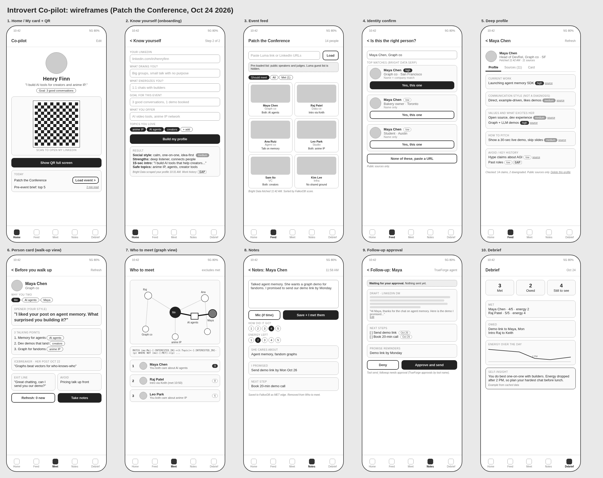

# Introvert Co-pilot: Build Plan and Wireframes
Patch the Conference Hackathon, Sat Oct 24 2026, Bright Data SF. All times PT.
Repo: `~/Developer/patch-hackathon`. App on port 3001. Feature freeze 4:30 PM. Submit 5:15 PM. Demo about 5:30 PM.
Tracks: Bright Data (lead), FalkorDB, TrueForge with OpenAI, Qodo.

Source docs: Developer Dossier (RL-289) and Tracks Guide (RL-292). Where this plan and the dossier differ, this plan wins (it has the final feature set).

---

## 0. How to use this file

- Each step below is ONE small pull request. Branch name, files, acceptance check and a Cursor prompt are given.
- Flow per step: `git checkout main && git pull && git checkout -b <branch>`, paste the Cursor prompt, run the acceptance check, `gh pr create --fill`, wait for the Qodo review (2 to 5 min), fix real findings, merge.
- Do not wait idle on Qodo. Start the next branch from `main` while the review runs, then rebase.
- Paste section 1 (stack) and section 3 (data model) into Cursor once at the start as `docs/PLAN.md` so every agent can read it. Every prompt below says "read docs/PLAN.md first".
- Wireframes are in `wireframes/` (one PNG per screen plus `wireframes-overview.png`). Point Cursor at the PNG for each screen: "match wireframes/05-deep-profile.png".

---

## 1. Stack (same as the dossier, do not change mid-day)

| Part | Choice |
|---|---|
| App | Next.js 15 App Router, TypeScript, Tailwind, `next dev -p 3001` |
| Graph | FalkorDB in Docker (`falkordb` npm client), graph name `copilot` |
| Data | Bright Data Web Scraper API (LinkedIn datasets), SERP API, Web Unlocker |
| AI | `openai` npm SDK, Responses API with Structured Outputs (`strict: true`) |
| Agent | TrueForge local (`npx @truefoundry/trueforge@latest`, port 8790) plus `@truefoundry/trueforge-sdk`. Fallback: plain OpenAI call |
| Graph view | `react-force-graph-2d` (dynamic import, `ssr:false`) |
| QR | `qrcode` npm (`QRCode.toDataURL`) |
| Cache | JSON files in `data/cache/` with `fetched_at`. No database besides FalkorDB |
| Review | Qodo GitHub app on every PR, `main` protected (PR required) |

Ports: 3001 app, 3000 FalkorDB Browser, 6379 FalkorDB, 8790 TrueForge, 3005 FalkorDB MCP (only if TrueForge is used).

### Folder structure
```
patch-hackathon/
  app/
    page.tsx                  Home: my card + QR
    me/page.tsx               Know yourself onboarding
    event/page.tsx            Event feed (load + grid)
    confirm/page.tsx          Identity confirm
    person/[id]/page.tsx      Deep profile (tabs: Profile, Sources)
    person/[id]/card/page.tsx Person card (walk-up view)
    meet/page.tsx             Who to meet + graph view
    brief/page.tsx            Pre-event brief (top 5)
    person/[id]/notes/page.tsx   Notes
    person/[id]/followup/page.tsx Follow-up approval
    debrief/page.tsx          Debrief + recap
    api/...                   (see section 5)
  components/  BottomNav.tsx QrCard.tsx PersonTile.tsx Claim.tsx GapBadge.tsx ConfidencePill.tsx GraphView.tsx SourceList.tsx
  lib/
    brightdata.ts   scrapeProfile, scrapeCompany, scrapePosts, serp, unlock, poll
    cache.ts        readCache, writeCache (data/cache/<kind>/<key>.json)
    openai.ts       client + runSchema(name, schema, system, user)
    schemas.ts      SELF_PROFILE, PERSON_PROFILE, NOTE_EXTRACT, FOLLOWUP, IDENTITY_MATCH
    prompts.ts      system prompts
    graph.ts        db connect, upsert helpers, golden queries
    validate.ts     source_url check, GAP enforcement, banned topics
    trueforge.ts    followup agent (with fallback)
  data/
    cache/          profile/ company/ posts/ serp/ unlock/ (git-ignored except demo/)
    demo/           event-ptc.json (10-15 public speakers/judges), me.json, 3 deep profiles
  scripts/
    seed.ts         loads data/demo into FalkorDB (run before demo)
    warm-cache.ts   triggers Bright Data for every demo URL
  docs/PLAN.md
  .env.local  .env.example  README.md
```

### Env vars (`.env.example`, never commit `.env.local`)
```
BRIGHTDATA_API_KEY=
BRIGHTDATA_SERP_ZONE=serp_api1        # name from Bright Data dashboard, confirm
BRIGHTDATA_UNLOCKER_ZONE=web_unlocker1 # name from Bright Data dashboard, confirm
OPENAI_API_KEY=
OPENAI_MODEL=                          # pick at venue from models the credits cover
FALKORDB_HOST=localhost
FALKORDB_PORT=6379
FALKOR_GRAPH=copilot
TRUEFORGE_URL=http://localhost:8790
USE_TRUEFORGE=true                     # set false to use plain OpenAI fallback
DEMO_MODE=true                         # read cache first, never block on live scrape
MY_LINKEDIN_URL=https://www.linkedin.com/in/<henry>
```

---

## 2. Bright Data usage per feature (with caching)

All calls go through `lib/brightdata.ts`. Every response is written to `data/cache/<kind>/<key>.json` as `{ fetched_at, source_url, request, data }`. Reads check the cache first. `DEMO_MODE=true` returns cache and refreshes in the background.

| Feature | Product | Call |
|---|---|---|
| My profile, attendee profile | Web Scraper API, People profiles `gd_l1viktl72bvl7bjuj0` | `POST https://api.brightdata.com/datasets/v3/scrape?dataset_id=gd_l1viktl72bvl7bjuj0&format=json` body `[{"url":"https://www.linkedin.com/in/<slug>"}]` |
| Company page | Company `gd_l1vikfnt1wgvvqz95w` | same endpoint with company URL |
| Latest posts / icebreaker | Posts `gd_lyy3tktm25m4avu764` | same endpoint; or use `posts[]` already on the profile |
| Feed batch (10-15 URLs) | Same datasets, async | `POST /datasets/v3/trigger?dataset_id=...` returns `snapshot_id`; poll `GET /datasets/v3/progress/{id}` until `ready`; `GET /datasets/v3/snapshot/{id}?format=json` |
| Identity confirm, deep research | SERP API | `POST https://api.brightdata.com/request` body `{"zone":SERP_ZONE,"url":"https://www.google.com/search?q=<q>&brd_json=1","format":"raw"}`. Queries: `"<name>" "<company>"`, `"<name>" podcast OR talk OR interview`, `"<name>" site:youtube.com`, `"<company>" news` |
| Article bodies | Web Unlocker | `POST https://api.brightdata.com/request` body `{"zone":UNLOCKER_ZONE,"url":"<article>","format":"raw","data_format":"markdown"}` (top 5 results only, trim to 4,000 chars each) |
| Refresh button | Profile + posts again | re-scrape, diff `posts[]` against cache, show "2 new since 11:42 AM" |
| Luma link (stretch) | Web Unlocker on the event page | parse visible hosts and speakers only. Guest lists are usually hidden, so demo uses `data/demo/event-ptc.json` labeled "Pre-loaded list: public speakers and judges" |

Rules:
- Sync scrape waits up to about 1 minute, then returns a `snapshot_id`. Treat a `snapshot_id` reply as "pending" and poll every 5 s.
- LinkedIn hides `position`, `experience`, `education` from logged-out views since Nov 13 2025. Never let the model fill them. Show `GAP`.
- Fields that work: `name, city, about, posts, activity, current_company, followers, recommendations, publications, projects, avatar, url, people_also_viewed`.
- Data quality checks (deterministic, in `lib/validate.ts`): URL normalized, name present, avatar URL loads, posts have dates, record count, `fetched_at` shown on screen.
- Credits: each request or record is about 1 credit. 5,000 free plus $50 venue credit. Cache everything so the demo costs zero.

---

## 3. Data model (FalkorDB)

Graph name `copilot`. Use `roQuery` for every read.

**Nodes**
| Label | Key props |
|---|---|
| `Me` | id="me", name, linkedin_url, avatar, intro_15s, social_style, strengths[], safe_topics[], drains, energizes, goal, offer |
| `Person` | id (LinkedIn slug), name, headline, city, avatar, linkedin_url, fetched_at, profile_json, confidence, last_seen_post_at |
| `Company` | id, name, url, about, fetched_at |
| `Topic` | id (lowercase slug), name |
| `Article` | id (url hash), url, title, kind (article, podcast, talk, interview, news, post), date, fetched_at |
| `Event` | id, name, date, venue, url, list_label |
| `Note` | id, text, created_at, cares_about[], promised[], next_step, rating, energy |
| `FollowUp` | id, draft, next_steps_json, status (draft, approved, denied, sent), created_at |

**Edges**
| Edge | From to | Props |
|---|---|---|
| `WORKS_AT` | Person/Me to Company | title |
| `INTERESTED_IN` | Me/Person to Topic | weight, source_url |
| `MENTIONED_IN` | Person to Article | |
| `ABOUT` | Article to Topic | |
| `ATTENDING` | Me/Person to Event | |
| `KNOWS` | Person to Person | via |
| `MET` | Me to Person | at, event_id, rating, energy |
| `HAS_NOTE` | Person to Note | |
| `HAS_FOLLOWUP` | Person to FollowUp | |

**Q1. Who to meet (ranked, excludes met, returns reason)**
```cypher
MATCH (me:Me {id:'me'})-[:ATTENDING]->(e:Event {id:$event})<-[:ATTENDING]-(p:Person)
WHERE NOT (me)-[:MET]->(p)
OPTIONAL MATCH (me)-[:INTERESTED_IN]->(t:Topic)<-[:INTERESTED_IN]-(p)
OPTIONAL MATCH (me)-[:INTERESTED_IN]->(t2:Topic)<-[:ABOUT]-(:Article)<-[:MENTIONED_IN]-(p)
OPTIONAL MATCH (me)-[:MET]->(m:Person)-[:WORKS_AT|KNOWS]-(x)-[:WORKS_AT|KNOWS]-(p)
WITH p, collect(DISTINCT t.name) AS shared, collect(DISTINCT t2.name) AS via_articles, collect(DISTINCT m.name) AS intros
RETURN p.id AS id, p.name AS name, p.avatar AS avatar, p.headline AS headline,
       shared, via_articles, intros,
       size(shared)*3 + size(via_articles)*2 + size(intros)*4 AS score
ORDER BY score DESC LIMIT 15
```
Reason line = first of: "Intro via {intros[0]}", "You both care about {shared[0]}", "Talked about {via_articles[0]} in a recent article", else "No shared ground found" (show this honestly).

**Q2. "Why you two" path for one person (for the graph view)**
```cypher
MATCH (me:Me {id:'me'}), (p:Person {id:$id})
MATCH path = shortestPath((me)-[*..4]-(p))
RETURN [n IN nodes(path) | {label: labels(n)[0], name: coalesce(n.name, n.title, n.id)}] AS nodes,
       [r IN relationships(path) | type(r)] AS rels
```
(FalkorDB supports `shortestPath` in MATCH with bounded length. If it errors, fall back to the explicit 2-hop topic match from Q1.)

**Q3. Mark as met (memory)**
```cypher
MATCH (me:Me {id:'me'}), (p:Person {id:$id})
MERGE (me)-[r:MET {event_id:$event}]->(p)
SET r.at = $at, r.rating = $rating, r.energy = $energy
CREATE (n:Note {id:$noteId, text:$text, created_at:$at, cares_about:$cares, promised:$promised, next_step:$next})
CREATE (p)-[:HAS_NOTE]->(n)
```

**Q4. Debrief recap**
```cypher
MATCH (me:Me {id:'me'})-[:ATTENDING]->(e:Event {id:$event})<-[:ATTENDING]-(p:Person)
OPTIONAL MATCH (me)-[m:MET]->(p)
OPTIONAL MATCH (p)-[:HAS_NOTE]->(n:Note)
RETURN p.name AS name, m IS NOT NULL AS met, m.rating AS rating, m.energy AS energy, m.at AS at,
       collect(n.promised) AS promised
ORDER BY met DESC, at
```

Show the Cypher text under the graph view in the UI (judges like seeing it).

---

## 4. OpenAI JSON schemas (Structured Outputs, strict)

All objects: `additionalProperties:false`, every key in `required`. If strict mode rejects `maxItems` or `enum`, drop them and clamp in code.

### 4a. SELF_PROFILE
```json
{
  "type":"object","additionalProperties":false,
  "required":["social_style","strengths","intro_15s","safe_topics","energy_tips","event_goal_line","gaps"],
  "properties":{
    "social_style":{"type":"object","additionalProperties":false,"required":["summary","evidence","confidence"],
      "properties":{"summary":{"type":"string"},"evidence":{"type":"string"},"confidence":{"type":"string","enum":["low","medium","high"]}}},
    "strengths":{"type":"array","items":{"type":"string"}},
    "intro_15s":{"type":"string","description":"about 40 words, first person, plain, in the user's own words"},
    "safe_topics":{"type":"array","items":{"type":"string"}},
    "energy_tips":{"type":"array","items":{"type":"string"},"description":"based on what drains and energizes"},
    "event_goal_line":{"type":"string"},
    "gaps":{"type":"array","items":{"type":"string"}}
  }
}
```
Input: my scraped LinkedIn (cached) plus the 5 answers.

### 4b. IDENTITY_MATCH (for confirm step)
```json
{"type":"object","additionalProperties":false,"required":["candidates"],
 "properties":{"candidates":{"type":"array","items":{"type":"object","additionalProperties":false,
   "required":["name","company","location","photo_url","linkedin_url","match_reason","confidence"],
   "properties":{"name":{"type":"string"},"company":{"type":"string"},"location":{"type":"string"},
     "photo_url":{"type":"string"},"linkedin_url":{"type":"string"},"match_reason":{"type":"string"},
     "confidence":{"type":"string","enum":["low","medium","high"]}}}}}}
```
Cheaper path: skip OpenAI and build candidates in code from SERP results that contain `linkedin.com/in/`, then scrape the top 3 profiles for photo and city.

### 4c. PERSON_PROFILE
Every claim is `{text, source_url, confidence}`. `source_url` must be a URL we fetched, or the literal `GAP`.
```json
{
  "type":"object","additionalProperties":false,
  "required":["identity","current_work","communication_style","values_motivations","excites_them",
              "talking_points","opener","how_to_pitch","avoid","exit_line","icebreaker_post","why_you_two",
              "key_history","gaps","evidence_quality"],
  "$defs":{"claim":{"type":"object","additionalProperties":false,"required":["text","source_url","confidence"],
     "properties":{"text":{"type":"string"},"source_url":{"type":"string"},"confidence":{"type":"string","enum":["low","medium","high"]}}}},
  "properties":{
    "identity":{"type":"object","additionalProperties":false,"required":["name","headline","company","location","linkedin_url"],
      "properties":{"name":{"type":"string"},"headline":{"type":"string"},"company":{"type":"string"},"location":{"type":"string"},"linkedin_url":{"type":"string"}}},
    "current_work":{"$ref":"#/$defs/claim"},
    "communication_style":{"$ref":"#/$defs/claim"},
    "values_motivations":{"type":"array","items":{"$ref":"#/$defs/claim"}},
    "excites_them":{"type":"array","items":{"$ref":"#/$defs/claim"}},
    "talking_points":{"type":"array","description":"exactly 3, each overlaps one of ME.safe_topics",
      "items":{"type":"object","additionalProperties":false,"required":["point","my_safe_topic","source_url","confidence"],
        "properties":{"point":{"type":"string"},"my_safe_topic":{"type":"string"},"source_url":{"type":"string"},"confidence":{"type":"string","enum":["low","medium","high"]}}}},
    "opener":{"type":"string","description":"under 25 words, in ME.social_style"},
    "how_to_pitch":{"$ref":"#/$defs/claim"},
    "avoid":{"type":"array","items":{"$ref":"#/$defs/claim"}},
    "exit_line":{"type":"string","description":"a warm, graceful way to end the chat"},
    "icebreaker_post":{"type":"object","additionalProperties":false,"required":["line","post_url","post_date"],
      "properties":{"line":{"type":"string"},"post_url":{"type":"string"},"post_date":{"type":"string"}}},
    "why_you_two":{"type":"string","description":"one line, will be checked against graph path"},
    "key_history":{"type":"array","items":{"$ref":"#/$defs/claim"}},
    "gaps":{"type":"array","items":{"type":"string"}},
    "evidence_quality":{"type":"string","enum":["thin","moderate","rich"]}
  }
}
```
If `$defs`/`$ref` fails in strict mode, inline the claim object.

System prompt additions (on top of dossier section 5.6): "This is a communication style read from public sources, not a psychological diagnosis. Use only SOURCES. Missing = GAP. Never mention or infer health, religion, politics, sexuality, ethnicity, family, age or other protected traits. No em dashes."

### 4d. NOTE_EXTRACT
```json
{"type":"object","additionalProperties":false,"required":["cares_about","i_promised","next_step","topics","learned_facts"],
 "properties":{"cares_about":{"type":"array","items":{"type":"string"}},
   "i_promised":{"type":"array","items":{"type":"string"}},
   "next_step":{"type":"string"},
   "topics":{"type":"array","items":{"type":"string"}},
   "learned_facts":{"type":"array","items":{"type":"string"}}}}
```

### 4e. FOLLOWUP (same shape from TrueForge or fallback)
```json
{"type":"object","additionalProperties":false,"required":["draft","next_steps","promise_reminders","missing"],
 "properties":{
   "draft":{"type":"object","additionalProperties":false,"required":["channel","subject","body"],
     "properties":{"channel":{"type":"string","enum":["linkedin_dm","email"]},"subject":{"type":"string"},"body":{"type":"string"}}},
   "next_steps":{"type":"array","items":{"type":"object","additionalProperties":false,"required":["action","why","due"],
     "properties":{"action":{"type":"string"},"why":{"type":"string"},"due":{"type":"string"}}}},
   "promise_reminders":{"type":"array","items":{"type":"string"}},
   "missing":{"type":"array","items":{"type":"string"}}}}
```

### Validator (`lib/validate.ts`, runs after every OpenAI call)
1. Every `source_url` is in the set of URLs we fetched for this person, or `GAP`. Otherwise set confidence to low and source to GAP.
2. `key_history` items with no source become GAP.
3. If `evidence_quality` is thin, no claim may be high.
4. Banned-term scan (health, religion, politics, sexuality, ethnicity, race, family, age, disability). Strip the claim.
5. Replace any em dash with a comma.
Show a small "Checked: 14 claims, 2 downgraded" line on the profile. That is the "proof stays deterministic" story.

---

## 5. API routes

| Route | Does | Sponsor |
|---|---|---|
| `GET/PUT /api/me` | Read/save my answers and self profile | |
| `POST /api/me/build` | Scrape my LinkedIn, run SELF_PROFILE, MERGE Me + topics | BD, OpenAI, Falkor |
| `POST /api/event/load` `{lumaUrl? , urls?[] , demo?:true}` | Create Event, trigger batch scrape, create Person + ATTENDING | BD, Falkor |
| `GET /api/event/:id/status` | Poll snapshot progress | BD |
| `GET /api/event/:id/feed` | Q1 ranked list with reason line | Falkor |
| `POST /api/identity` `{name, company?}` | SERP, top 3 candidates | BD |
| `POST /api/person/:id/research` | Profile + company + posts + SERP + Unlocker top 5, cache all | BD |
| `POST /api/person/:id/profile` | PERSON_PROFILE + validator, MERGE graph | OpenAI, Falkor |
| `GET /api/person/:id` | Profile JSON + sources + fetched_at | |
| `POST /api/person/:id/refresh` | Re-scrape posts, return new since last look | BD |
| `DELETE /api/person/:id` | Delete node, edges and cache files ("delete on request") | Falkor |
| `GET /api/person/:id/path` | Q2 path nodes and edges | Falkor |
| `GET /api/brief?event=` | Top 5 from Q1 + their openers as a 2-minute read | Falkor, OpenAI |
| `POST /api/person/:id/notes` `{text, rating, energy}` | NOTE_EXTRACT, Q3 MET edge | OpenAI, Falkor |
| `POST /api/person/:id/followup` | TrueForge session (or fallback), returns FOLLOWUP + approval id | TrueForge, OpenAI |
| `POST /api/followup/:id/approve` and `/deny` | Resolve approval; "send" = copy to clipboard or email to Henry's own inbox | TrueForge |
| `GET /api/debrief?event=` | Q4 recap + self-insight (OpenAI over my MET ratings) | Falkor, OpenAI |

---

## 6. The build, step by step

Times assume solo with Cursor agents. Each block ends with a merged PR.

### Step 0 (10:30 to 10:50) Repo, Qodo, skeleton
- Branch: `chore/skeleton`
- Files: `package.json`, `app/layout.tsx`, `app/page.tsx` (placeholder), `components/BottomNav.tsx`, `.env.example`, `.gitignore` (adds `.env.local`, `data/cache/*` but keeps `data/demo/`), `docs/PLAN.md` (this file), `README.md`, `lib/graph.ts` (connect + `ping()`), `app/api/health/route.ts`.
- Before the PR: `docker run -d --name falkor -p 6379:6379 -p 3000:3000 -v falkor-data:/data falkordb/falkordb`. On GitHub: create repo, Settings > Branches > protect `main` (require PR). Install Qodo from app.qodo.ai on that org/repo.
- Accept: `npm run dev` on 3001 loads, `curl localhost:3001/api/health` returns `{ok:true, falkor:true}`, PR shows a Qodo review comment.
- Cursor prompt:
```
Read docs/PLAN.md. Create a Next.js 15 App Router + TypeScript + Tailwind app in this folder (if not present), dev script "next dev -p 3001". Add a mobile-first layout (max-w-[420px] mx-auto, grayscale palette, system font) with a fixed BottomNav: Home, Feed, Meet, Notes, Debrief. Add lib/graph.ts that connects to FalkorDB with the falkordb npm client using FALKORDB_HOST/PORT and selects graph FALKOR_GRAPH, exporting query() and roQuery() helpers and ping(). Add app/api/health/route.ts returning {ok:true, falkor:boolean}. Add .env.example exactly as in docs/PLAN.md section 1, .gitignore for .env.local and data/cache/ (keep data/demo/). Keep it minimal. No em dashes in any copy.
```

### Step 1 (10:50 to 11:30) Bright Data client + cache + warm the demo NOW
- Branch: `feat/brightdata-client`
- Files: `lib/brightdata.ts`, `lib/cache.ts`, `scripts/warm-cache.ts`, `data/demo/event-ptc.json`, `app/api/person/[id]/research/route.ts` (profile only for now).
- Fill `event-ptc.json` yourself with 10 to 15 public LinkedIn URLs of today's speakers, judges and sponsor staff, plus your own URL. Label: "Pre-loaded list: public speakers and judges."
- Run `npx tsx scripts/warm-cache.ts` as soon as it works. It uses async trigger + poll. Let it run in the background.
- Accept: `data/cache/profile/<slug>.json` exists with `fetched_at` for you and at least 5 demo people. A `snapshot_id` reply is handled as pending, not an error.
- Cursor prompt:
```
Read docs/PLAN.md section 2. Implement lib/cache.ts (readCache(kind,key), writeCache(kind,key,{source_url,request,data}) that adds fetched_at ISO, stored at data/cache/<kind>/<key>.json) and lib/brightdata.ts with: scrapeProfile(url), scrapeCompany(url), scrapePosts(url) using POST https://api.brightdata.com/datasets/v3/scrape?dataset_id=<id>&format=json (ids in PLAN), Bearer BRIGHTDATA_API_KEY. If the response contains snapshot_id instead of data, poll GET /datasets/v3/progress/{id} every 5s until ready (timeout 180s) then GET /datasets/v3/snapshot/{id}?format=json. Add triggerBatch(datasetId, urls) using /datasets/v3/trigger. Add serp(query) and unlock(url) using POST https://api.brightdata.com/request with zones from env (serp url: google search with brd_json=1; unlock with data_format markdown). Every function checks cache first and writes cache after. Normalize LinkedIn URLs to https://www.linkedin.com/in/<slug>. Add scripts/warm-cache.ts that reads data/demo/event-ptc.json + MY_LINKEDIN_URL and batch-scrapes profiles, then companies. Never log the API key.
```

### Step 2 (11:30 to 12:15) Know yourself + Home card with QR
- Branch: `feat/me-and-home`
- Files: `app/me/page.tsx`, `app/page.tsx`, `components/QrCard.tsx`, `lib/openai.ts`, `lib/schemas.ts` (SELF_PROFILE), `lib/prompts.ts`, `app/api/me/route.ts`, `app/api/me/build/route.ts`, `data/demo/me.json`.
- Accept: fill the 5 questions, press Build, see social style, strengths, 15-second intro, safe topics within 20 s. Home shows photo, name, intro, goal and a QR that opens your LinkedIn when scanned with your phone. "Show QR" fills the screen. Graph has `(:Me)` with `INTERESTED_IN` topics (check in localhost:3000).
- Cursor prompt:
```
Read docs/PLAN.md sections 3, 4a, 5 and match wireframes/01-home-qr.png and wireframes/02-know-yourself.png. Build lib/openai.ts with runSchema(name, schema, system, user) using the Responses API, text.format json_schema strict true, model OPENAI_MODEL, returning parsed JSON. Add SELF_PROFILE to lib/schemas.ts. Build app/me/page.tsx: LinkedIn URL input + 5 questions (what drains you, what energizes you, goal for this event, what you offer, topics you love) + Build button with step status (Scraping LinkedIn via Bright Data, Building profile, Saving to graph). POST /api/me/build scrapes MY profile with lib/brightdata (cache first), runs SELF_PROFILE, saves data/demo/me.json, and MERGEs (:Me {id:'me'}) plus (:Topic) nodes with INTERESTED_IN edges and WORKS_AT company. Home app/page.tsx shows avatar, name, intro_15s, event goal, and a large QR (qrcode npm toDataURL of my LinkedIn URL) with a "Show QR" button that opens a full-screen white overlay. Missing fields show a GapBadge "GAP". No em dashes.
```

### Step 3 (12:15 to 1:00) Event feed
- Branch: `feat/event-feed`
- Files: `app/event/page.tsx`, `components/PersonTile.tsx`, `app/api/event/load/route.ts`, `app/api/event/[id]/status/route.ts`, `app/api/event/[id]/feed/route.ts`, `lib/graph.ts` (add Q1, upsertPerson).
- Accept: "Load demo event" shows a 2-column grid of 10 to 15 cards with photo, name, title/company (or GAP), and a one-line reason. Sorted by score. Banner reads "Pre-loaded list: public speakers and judges". Tap goes to `/person/[id]`.
- Cursor prompt:
```
Read docs/PLAN.md sections 2, 3 (Q1) and 5. Match wireframes/03-event-feed.png. POST /api/event/load accepts {demo:true} | {urls:string[]} | {lumaUrl}. demo loads data/demo/event-ptc.json. For each URL, use cached Bright Data profile (or triggerBatch for missing ones), then MERGE (:Event), (:Person {id:slug}) with name, headline, avatar, city, linkedin_url, fetched_at, (:Company) with WORKS_AT, topics from about/posts (simple keyword extraction is fine for now) with INTERESTED_IN, and (Me)-[:ATTENDING]->(Event)<-[:ATTENDING]-(Person). GET /api/event/[id]/feed runs Q1 and builds the reason line as described. Feed page: event header, list label banner, filter chips (All, Should meet, Met), 2-col grid of PersonTile (photo, name, company, reason, score dot). lumaUrl path: unlock the page and extract visible host/speaker names only; if none, show "Guest list is hidden on Luma. Paste LinkedIn URLs instead."
```

### 1:00 PM CHECKPOINT
Must be true:
- [ ] Paste a URL, Bright Data data comes back (live or cache) with `fetched_at` shown.
- [ ] My profile and Home QR work.
- [ ] Feed shows real demo people from the graph.
- [ ] 3 to 4 PRs merged with Qodo reviews.
- [ ] Demo cache: me + at least 10 feed people done.
**TrueForge go/no-go (5 minutes, no more):** does `npx @truefoundry/trueforge@latest` run on 8790 with the OpenAI key, and can a test agent reply? If yes, `USE_TRUEFORGE=true`. If no, set false and build the fallback in Step 7. Ask the TrueForge booth one question if stuck, then move on.
If behind by more than 30 minutes: merge Steps 5 and 6 into one simpler person page, skip identity confirm (use direct URL).

### Step 4 (1:00 to 1:30) Identity confirm
- Branch: `feat/identity-confirm`
- Files: `app/confirm/page.tsx`, `app/api/identity/route.ts`.
- Accept: type "name + company", see 2 to 3 candidate cards with photo, company, location and match reason. "Yes, this one" goes to research. "None of these" lets you paste a URL.
- Cursor prompt:
```
Read docs/PLAN.md and match wireframes/04-identity-confirm.png. POST /api/identity {name, company?} runs serp('"<name>" "<company>" site:linkedin.com/in') via lib/brightdata (cached), takes up to 3 results with linkedin.com/in URLs, scrapes those profiles (cached) for avatar, current_company, city, and returns candidates [{name, company, location, photo_url, linkedin_url, match_reason, confidence}] where confidence is high if name and company both match. Page shows a search input, then candidate cards each with "Yes, this one" (navigates to /person/<slug>?research=1) and a "None of these, paste URL" fallback. Note under results: "Public sources only."
```

### Step 5 (1:30 to 2:30) Deep research + deep profile
- Branch: `feat/deep-profile`
- Files: `app/api/person/[id]/research/route.ts` (full), `app/api/person/[id]/profile/route.ts`, `app/api/person/[id]/route.ts` (GET, DELETE), `app/person/[id]/page.tsx`, `components/Claim.tsx`, `components/ConfidencePill.tsx`, `components/SourceList.tsx`, `lib/schemas.ts` (PERSON_PROFILE), `lib/validate.ts`, `lib/graph.ts` (upsert Articles/Topics).
- Accept: for one demo person, research collects profile, company, posts, 4 SERP queries and up to 5 Unlocker article bodies, each cached with URL and date. Profile page shows each section with a confidence pill and a source link per claim, GAP badges, "Communication style read from public sources. Not a diagnosis." and "Public sources only" notes, a Sources tab, a "Checked: N claims, M downgraded" line, and a "Delete this profile" button that removes node and cache.
- **Kick off deep research for the 3 demo people as soon as this works (target done by 3:00).**
- Cursor prompt:
```
Read docs/PLAN.md sections 2, 3, 4c and validator, and match wireframes/05-deep-profile.png. Research route: gather scrapeProfile, scrapeCompany (current_company link), posts from profile, serp for '"<name>" "<company>"', '"<name>" podcast OR talk OR interview', '"<name>" site:youtube.com', '"<company>" news', then unlock() the top 5 non-LinkedIn result URLs (markdown, trim 4000 chars). Save each as a source {kind, url, title, date|GAP, fetched_at}. Profile route: build SOURCES list, call runSchema with PERSON_PROFILE and the system prompt (dossier 5.6 plus PLAN additions), passing ME (safe_topics, social_style, offer, goal). Run lib/validate.ts (source_url must be in fetched set or GAP, thin evidence means no high, banned-topic strip, em dash removal) and return counts. MERGE Person, Company, Topic, Article nodes with MENTIONED_IN and ABOUT edges, store profile_json. Page: header (photo, name, headline, company, fetched_at, Refresh button stub), tabs Profile | Sources, sections Current work, Communication style, Values and motivations, What excites them, How to pitch, Avoid, Key history; each claim rendered with Claim component (text, ConfidencePill high/medium/low, source link or GAP badge). Footer notes and Delete button (DELETE /api/person/[id] removes node, edges and cache files after confirm()).
```

### Step 6 (2:30 to 3:15) Person card + Who to meet + Brief
- Branch: `feat/card-meet-brief`
- Files: `app/person/[id]/card/page.tsx`, `app/meet/page.tsx`, `components/GraphView.tsx`, `app/api/person/[id]/path/route.ts`, `app/api/person/[id]/refresh/route.ts`, `app/brief/page.tsx`, `app/api/brief/route.ts`.
- Accept: card shows big-type opener, 3 talking points (each tagged with my safe topic), icebreaker from latest post with date, exit line, one thing to avoid, "why you two" path chips. Refresh says "N new posts since <time>". Meet page lists the top people with reason and a 2D graph that highlights Me to Topic to Person path, with the Cypher shown. Brief shows top 5 in under 2 minutes of reading.
- Cursor prompt:
```
Read docs/PLAN.md (Q1, Q2) and match wireframes/06-person-card.png and wireframes/07-who-to-meet.png. Person card page (walk-up view, large text): name + photo, "Why you two" as path chips from GET /api/person/[id]/path (Q2), Opener (big), 3 talking points with my_safe_topic tag, Icebreaker from latest post (line, date, link), "If you need to leave" exit_line, "Avoid" one item, buttons: Refresh, Take notes, I met them. Refresh route re-scrapes posts (bypass cache), diffs against cached posts and returns new ones, updates last_seen_post_at. Meet page: ranked list from Q1 (excluding MET), tap a row to highlight its path in GraphView (react-force-graph-2d via next/dynamic ssr:false, grayscale nodes, Me in center, highlighted path in black), and a collapsible "Cypher" block showing the query text. Brief page: top 5 from Q1 with name, one-line why, opener, one talking point, estimated read time label "2 min read".
```

### Step 7 (3:15 to 3:45) Notes + Follow-up (TrueForge or fallback)
- Branch: `feat/notes-followup`
- Files: `app/person/[id]/notes/page.tsx`, `app/api/person/[id]/notes/route.ts`, `app/person/[id]/followup/page.tsx`, `app/api/person/[id]/followup/route.ts`, `app/api/followup/[id]/approve/route.ts`, `app/api/followup/[id]/deny/route.ts`, `lib/trueforge.ts`, optional `mcp/outbox/` (tiny MCP with `save_draft`, `send_followup`).
- Accept: type a note, rate chat 1 to 5 and energy 1 to 5, Save shows extracted "cares about / I promised / next step", MET edge appears and the person drops off Who to meet. Follow-up page shows the draft, next steps with due dates and promise reminders, with Edit, Approve and Deny. Nothing sends until Approve. Approve = copy to clipboard (or email to Henry's own inbox). If TrueForge: the session shows in the TrueForge Sessions view and the approval pause on `send_followup`.
- Cursor prompt:
```
Read docs/PLAN.md (Q3, 4d, 4e, dossier 5.7) and match wireframes/08-notes.png and wireframes/09-followup.png. Notes page: textarea, two 1-5 selectors (How did it go, Energy left), "I met them" is implied on save. POST /api/person/[id]/notes runs NOTE_EXTRACT and Q3 (MERGE MET edge with rating, energy, create Note). Show the extraction result. lib/trueforge.ts: if USE_TRUEFORGE=true, use @truefoundry/trueforge-sdk to create/get an agent "followup" with instructions from dossier 5.7, require_approval_for_tools ["send_followup"], response_format FOLLOWUP schema, start a session with person profile + notes, stream until a draft and an approval request arrive, return {followup, approval_id}. Else fallback: runSchema FOLLOWUP directly and return approval_id = local uuid. Store (:FollowUp {status:'draft'}). Follow-up page: draft (editable), next steps with due dates, promise reminders, a "Nothing sent yet" status, buttons Approve and send, Deny. Approve resolves the TrueForge approval (or local), sets status approved, copies body to clipboard. Never send without Approve.
```

### 3:45 PM CHECKPOINT
- [ ] Full path works on one cached person: Home, Feed, Confirm, Deep profile, Card, Notes, Follow-up approve.
- [ ] 3 deep profiles cached. Feed cached. Run `npx tsx scripts/seed.ts` from a clean graph and the demo still works.
- [ ] 6+ PRs merged with Qodo reviews. Screenshot 2 real Qodo findings you fixed.
- If Debrief is not started: build only the recap list and a labeled example insight.

### Step 8 (3:45 to 4:15) Debrief
- Branch: `feat/debrief`
- Files: `app/debrief/page.tsx`, `app/api/debrief/route.ts`.
- Accept: shows Met (with rating and energy), Owed (promises), Still to see (top unmet from Q1), an energy line chart over the day, and one self-insight sentence. If fewer than 3 notes exist, show the insight card from `data/demo/debrief-example.json` labeled "Example from cached data".
- Cursor prompt:
```
Read docs/PLAN.md (Q4) and match wireframes/10-debrief.png. GET /api/debrief?event= runs Q4 and Q1 (unmet top 3), collects promises from notes, and if 3+ MET edges exist calls OpenAI (plain JSON schema {insight:string, best_conditions:string, energy_pattern:string}) over the ratings, energy and times; otherwise returns data/demo/debrief-example.json with example:true. Page: summary counts (Met, Owed, Still to see), list sections, a simple SVG energy line (energy by time of MET), Self-insight card, and an "Example from cached data" label when example is true. No em dashes.
```

### Step 9 (4:15 to 4:30) Polish + seed + freeze
- Branch: `chore/polish-seed`
- Files: `scripts/seed.ts`, loading states, error states ("Scrape still running, showing cached data from 11:42 AM"), README sections.
- Accept: `docker restart falkor && npx tsx scripts/seed.ts` then the whole demo runs with Wi-Fi off except OpenAI (or fully cached).
- Cursor prompt:
```
Add scripts/seed.ts that clears graph FALKOR_GRAPH and rebuilds Me, Event, Persons, Companies, Topics, Articles from data/demo and data/cache only (no network). Add loading and error states to every API call (show cached data with its fetched_at when live fails). Update README with: what it does, the sponsor table (Bright Data, FalkorDB, TrueForge with OpenAI, Qodo, each with "remove it and X breaks"), how to run (docker, env, npm run dev on 3001, seed), privacy notes (public sources only, delete on request, approval before send), and a "Qodo Code Review Evidence" section with links to PRs.
```

**4:30 PM: FEATURE FREEZE.** Only bug fixes after this.

### 4:30 to 5:15 Rehearse and submit
- Rehearse the 3-minute demo twice with a timer. Record a backup screen video (QuickTime) of one clean run.
- Submit by 5:15 (see checklist).

---

## 7. Cut list (in this order, only if behind)
1. Voice notes (never started unless ahead at 3 PM).
2. Energy chart and multi-event learning (use the labeled example card).
3. TrueForge (use the plain OpenAI fallback, keep the Approve button).
4. Path animation (use static highlighted path, or FalkorDB Browser at localhost:3000).
5. Luma link loader (keep the pre-loaded list).
6. Pre-event brief page (the Meet list covers it).
Never cut: live Bright Data with fetched_at, GAP handling, the graph "why" path, the approval gate, Qodo PRs.

---

## 8. Demo script (3 minutes, click by click)

| Time | Click | Say |
|---|---|---|
| 0:00 | Home screen | "I'm an introvert. Conferences drain me. This is my co-pilot." |
| 0:10 | Tap Show QR | "My card. People scan this instead of me spelling my name." |
| 0:20 | Me tab, show built profile | "I told it what drains me and what I love. It wrote my 15-second intro and my safe topics. Bright Data pulled my LinkedIn." |
| 0:40 | Feed, Load demo event | "Pre-loaded list of today's public speakers and judges. Bright Data scraped each one. Sorted by who I should meet, and each card says why." |
| 1:00 | Tap a top card, then Confirm screen | "First it checks it's the right person. Same names are common." Tap "Yes, this one." |
| 1:10 | Deep profile | "Bright Data SERP and Web Unlocker found her talks and articles. Every line has a source and a confidence. LinkedIn hides job history now, so it says GAP instead of guessing. It's a communication style read, not a diagnosis." Point at "Checked: 14 claims, 2 downgraded." |
| 1:35 | Person card | "Before I walk up: an opener in my style, three talking points from my safe topics, an icebreaker from her post this week, and a polite exit line." Tap Refresh: "Live data, nothing new since 11:42." |
| 1:55 | Meet tab, tap her row | "FalkorDB shows why: me, agent memory, her. Here is the Cypher." |
| 2:10 | Notes: type "Talked agent memory, I promised to send our demo" and Save | "OpenAI pulls what she cares about and what I promised. FalkorDB saves that I met her." Go back to Meet: "She's gone from the list and a new intro path appeared." |
| 2:30 | Follow-up | "The TrueForge agent wrote the follow-up in my voice and stopped. Nothing leaves without me." Tap Approve. |
| 2:45 | Debrief | "End of day: who I met, what I owe, who's left, and what I learned about myself." |
| 2:55 | Close | "Bright Data finds them, OpenAI reads them, FalkorDB remembers, TrueForge follows up, and Qodo reviewed every PR." |

Have the backup video ready on a second tab.

---

## 9. Submission checklist (by 5:15)
- [ ] Repo public, README complete (sponsor table, run steps, privacy, Qodo evidence).
- [ ] `.env.local` not committed. `git log -p | grep -i "api_key\|token"` is clean. Bright Data MCP URL with token not in repo.
- [ ] 2-minute video or screenshots attached if the form asks.
- [ ] Submit on the method announced at 9 AM. Select every track: Bright Data, FalkorDB, TrueForge with OpenAI, Qodo.
- [ ] Short description (paste): "An introvert's conference co-pilot. Know yourself, see who to meet and why, walk up with a sourced opener, take notes, and approve a follow-up. Bright Data for live public data, FalkorDB for memory and the why-path, TrueForge with OpenAI for the approval-gated follow-up, Qodo reviewed every PR."
- [ ] Laptop charged, app running on 3001, seed run, cached mode on, backup video open.

---

## 10. Wireframes

Files in `wireframes/`:
01-home-qr.png, 02-know-yourself.png, 03-event-feed.png, 04-identity-confirm.png, 05-deep-profile.png, 06-person-card.png, 07-who-to-meet.png, 08-notes.png, 09-followup.png, 10-debrief.png, and wireframes-overview.png (all ten side by side).



ASCII quick view (Home and Person card):
```
+----------------------+   +----------------------+
| Co-pilot        [Me] |   | < Back    Person card|
|   ( photo )          |   | (o) Maya Chen        |
|   Henry Finn         |   | Why you two:         |
|   "I build AI..."    |   | [Me]-[agent memory]- |
|   Goal: 3 good chats |   | [Maya]               |
|  +--------------+    |   | OPENER               |
|  |  QR  CODE    |    |   | "Saw your post on..."|
|  +--------------+    |   | Talking points x3    |
|  [ Show QR ]         |   | Icebreaker (Oct 22)  |
|  Next: Load event >  |   | Exit line  | Avoid   |
| Home Feed Meet Notes |   | [Refresh] [Notes]    |
+----------------------+   +----------------------+
```
