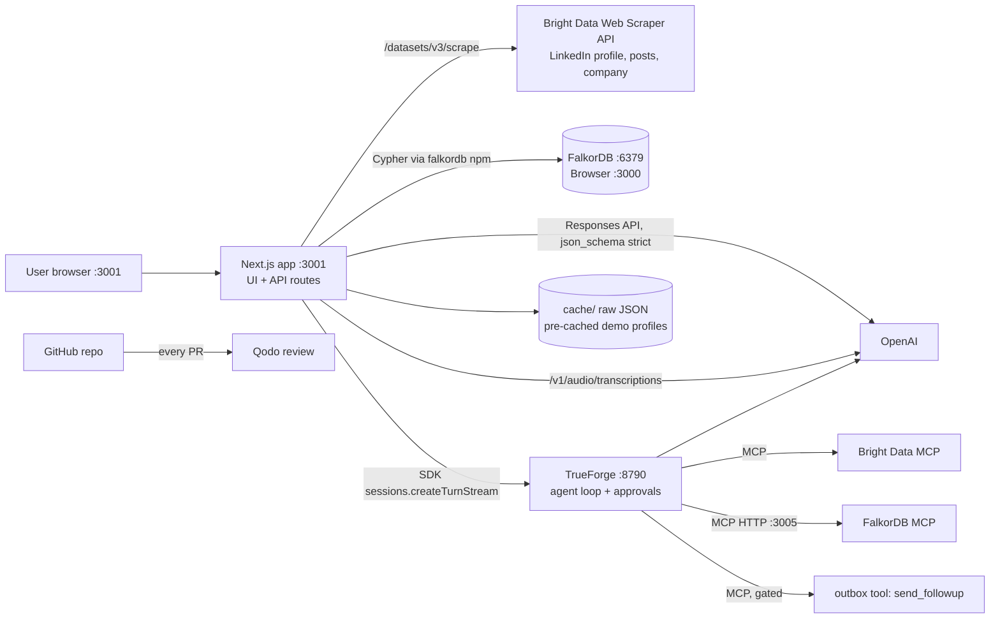

# Developer Briefing Dossier: Patch the Conference Hackathon (Sat Oct 24, 2026)

Prepared Friday Oct 23, 2026, evening PT, for Henry Finn and any teammate joining him. Read this top to bottom once tonight. Keep it open on the day.

Labels used below:
- **[V]** = verified on an official or primary source (URL in section 11).
- **[Plan]** = our recommendation or design. Judgment, not fact.
- **Unconfirmed, ask at 9 AM** = not published anywhere we could find. Ask an organizer in person.

Working product name in this doc: **Warm Intro** (placeholder; rename freely).

---

## 1. One-page TL;DR

**The event.** WeMakeDevs and Bright Data run "Patch the Conference Hackathon" on Saturday Oct 24, 2026, 9:00 AM to 7:00 PM PT, at the Bright Data office, 625 2nd St, San Francisco [V]. Theme: find something broken about conferences and ship the fix, right before GitHub Universe (Oct 28 to 29) [V]. Solo or teams of up to 4. 21+ with government photo ID, no exceptions [V]. Submissions close **5:30 PM**. Demos and judging 5:30 to 6:30 PM, winners 6:30 PM [V]. Every track requires a demo that runs **live on stage** [V].

**Prizes (one per track) [V].** FalkorDB: iPhone Duos, or cash instead. Henry's Win Plan v2 (Research Library RL-288) reports that the signed-in Luma announcement states **$2,000 cash**; this dossier could not open that announcement itself, so confirm at 9 AM. Bright Data: $1,500. TrueForge with OpenAI: $1,000. Qodo: $500. Venue credits: OpenAI $50 and Bright Data $50, claim method explained on site [V].

**What we build.** A networking co-pilot for introverted conference attendees. Paste a LinkedIn profile URL. Bright Data fetches the public profile, recent posts and company page. OpenAI turns that into a short, sourced briefing: what the person does, likely communication style, personality estimate (labeled as an estimate), talking points, three openers, how to present yourself so it lands, what to avoid, and follow-up ideas. FalkorDB stores people, companies, topics and events as a graph, so the app can say who to meet and why, and show the path (shared topic, shared company, mutual intro). After the conversation you type or speak a note. A TrueForge agent on OpenAI suggests next steps and drafts a follow-up message that waits for your approval. Every code change ships through a small PR reviewed by Qodo.

**Track strategy [Plan].** Default lead is **Bright Data** (Bright Data's own idea list includes "a who-to-meet scout that uses LinkedIn profiles and company data") [V], with FalkorDB second. The switch rule is: lead with FalkorDB if the iPhone cash option is about $2,000 or more AND a team can win only one track. RL-288 reports the cash option is $2,000, so if the organizer confirms that figure, **the whole decision comes down to the multi-track answer at 9 AM**: one win per team means lead with FalkorDB; multiple wins allowed means lead with Bright Data and build for all four. Build the same app either way. Qodo runs all day in the background. Drop TrueForge at 1 PM if it is not working.

**Five rules for the day.**
1. No project code before 9 AM. A past WeMakeDevs hackathon required code to be written during the event; old repos are reference only [V precedent, PTC rule Unconfirmed, ask at 9 AM].
2. Never start a cold Bright Data LinkedIn scrape live on stage. A sync call can wait up to a minute before handing back a snapshot ID [V]. Pre-cache the demo profiles.
3. Public LinkedIn data only. No logged-in scraping. Bright Data itself only collects public fields [V].
4. Run our Next.js app on **port 3001**. FalkorDB Browser owns port 3000 [V].
5. Feature freeze 4:30 PM. Submit by 5:15 PM.

**Data reality check [V].** Since Nov 13, 2025, LinkedIn hides Position, Experience and Education from logged-out views. Bright Data says fill rates for those three fields fell to about 2% and they now come from a stale cache. Name, about, city, current company, posts, activity, recommendations, languages, certifications, publications, projects and similar fields still refresh. Design the profile prompt around `about`, `posts`, `current_company` and the company page, and mark work history as GAP when it is missing.

---

## 2. The event

### 2.1 Facts

| Item | Detail | Status |
|---|---|---|
| Name | Patch the Conference Hackathon (Luma title: "Win iPhone Duos at Patch the Conference Hackathon") | [V] luma.com/ptc |
| Hosts | Bright Data and WeMakeDevs | [V] |
| Date and time | Sat Oct 24, 2026, 9:00 AM to 7:00 PM PT | [V] |
| Venue | Bright Data, 625 2nd St, San Francisco, CA 94107 | [V] |
| Entry | Free. 21+. Government photo ID checked at the door, no exceptions | [V] |
| Teams | Solo or up to 4 | [V] |
| Bring | Laptop, charger, ID. We add a phone hotspot | [V] for laptop and charger |
| Theme | "Find what's broken about conferences and ship the patch," right before GitHub Universe | [V] |
| GitHub Universe | Oct 28 to 29, 2026, Fort Mason Center, SF | [V] githubuniverse.com |
| Henry's registration | Confirmed on henry@0n1force.com, Oct 23, 3:16 PM PT | [V] Luma email |
| Written rules page | None. /ptc/rules, /faq, /projects, /submit returned 404 on Oct 23 | [V] |
| Submission method | Not published | Unconfirmed, ask at 9 AM |

### 2.2 Schedule (PT) [V]

| Time | What |
|---|---|
| 9:00 AM | Doors open |
| 9:00 to 10:00 | Breakfast, setup, start hacking |
| 10:00 to 11:00 | Sponsor workshops and talks |
| 11:00 AM to 2:00 PM | Build |
| 2:00 PM | Pizza lunch |
| 2:00 to 5:30 PM | Keep building and submit. **Submissions close 5:30 PM** |
| 5:30 to 6:30 PM | Presentations and judging on stage |
| 6:30 PM | Winners announced |
| 7:00 PM | Event ends |

A third-party listing (Conference Radar) says submissions at 6:00 PM. Treat 5:30 PM as the hard deadline.

### 2.3 Official judging criteria per track [V]

**FalkorDB (iPhone Duos)**
- Graph at the core: FalkorDB does real work (multi-hop queries, memory, shared state between agents), not just storing rows.
- Explainable answers: show how the project reached its answer through the graph.
- Solves a real conference problem.
- Working demo, live on stage.

**Bright Data ($1,500)**
- Hard-to-get data at the core: the project depends on Bright Data for fresh data from sites a basic script cannot reliably reach.
- Data quality: accurate, up to date, handled well when a site changes or a request fails.
- Usefulness: saves real time or money around conferences.
- Working demo, live on stage.

**TrueForge with OpenAI ($1,000)**
- Built on TrueForge: the agent runs on TrueForge and makes good use of its tools, sandbox, skills or approvals.
- Powered by OpenAI: OpenAI models do the heavy lifting.
- Solves a real conference problem.
- Working demo, live on stage.

**Qodo ($500)**
- Qodo installed and reviewing real PRs throughout the day.
- Small, clear PRs with sensible descriptions.
- You fixed what Qodo found and can show a couple of examples in the demo.
- Clean repo by the end of the day.

Sponsor-suggested ideas that match our app [V]: FalkorDB "a networking agent that suggests who to meet based on shared topics and projects, and remembers who you've already spoken to." Bright Data "a who-to-meet scout that uses LinkedIn profiles and company data to rank the people worth finding." TrueForge "a follow-up agent that turns the contacts and notes from your day into personalised follow-up emails, and waits for your approval before sending."

### 2.4 Prizes and the multi-track question

| Track | Prize | Notes |
|---|---|---|
| FalkorDB | iPhone Duos or cash | "If you win and don't want the phone, you can take the cash prize instead" [V]. Cash amount: $2,000 per Henry's Win Plan v2 (RL-288), citing the signed-in Luma announcement; not opened by this dossier, so confirm at 9 AM. Whether "Duos" means one per teammate: Unconfirmed, ask at 9 AM |
| Bright Data | $1,500 | [V] |
| TrueForge with OpenAI | $1,000 | [V] |
| Qodo | $500 | [V] |

Whether one team can win more than one track: Unconfirmed, ask at 9 AM. WeMakeDevs precedent goes both ways. Agent Harness rules said "One team can only take one of them." Graph Hacks rules said "You may enter any or all of them" [V both pages].

### 2.5 Judges and what each likely values

Names and roles are from the official judges page [V]. "Likely values" is our inference from their roles and public work [Plan], not something they said.

| Judge | Role | What they will probably reward |
|---|---|---|
| Riken Shah | Human Data Team (Contractor), xAI | Data provenance and labeling. Every claim in the profile should show its source URL and a confidence label |
| Nitish Mane | Software Engineer, Philo | Won 1st at WeMakeDevs "Zero Downtime" (Bright Data, SF, Aug 22, 2026) with "Scraper Factory", self-healing scrapers with a deterministic verifier; his stated rule is "judgment goes to the agents, proof stays deterministic" [V]. Also built "sre-oncall" on TrueForge [V]. Show deterministic checks around the LLM output, a handled failure, and the approval gate |
| Manpreet Singh | Software Engineer II, Northwest Bank | Clean code, a UI that works, safety around personal data |
| Schezeen Fazulbhoy | Senior Software Engineer, Adobe | Polished, clear UX; a demo that does not stall |
| Pooja Ravi | Senior Software Engineer, Netflix | Reliability, caching, graceful fallback when a call fails |
| Satyam Singh | Co-Founder and CTO, Simulithic | Product sense. "Would I use this at Universe next week?" |
| Yash Bhatia | Senior Data Engineer, Meta | Data quality: schema, dedupe, entity resolution (same person or company from two sources merged), freshness timestamps |

Which judge scores which track: Unconfirmed, ask at 9 AM.

### 2.6 What won past WeMakeDevs events [V]

- **Zero Downtime (Bright Data, Aug 2026).** Winner Scraper Factory: a small real product on top of scrapers with a deterministic verifier that refused a bad repair live.
- **Agent Harness (TrueForge, Qodo, Bright Data, Aug 2026).** ONCALL (Best Use of TrueForge): rollback steps written before acting, survives a restart, human approves. CapyGuard (Best Code Quality, Qodo): reader and judge as separate agents, a prompt-only boundary rebuilt structurally after review caught it.
- **Memory Meets Motion (FalkorDB, Aug 2026).** Atrium won on a two-hop Cypher traversal that "a flat table or vector search simply cannot express," and each sponsor tool owned one job with a "removing it breaks X" table.

Pattern [Plan]: one narrow real problem, real live data, each sponsor tool does load-bearing work, every answer traces to evidence, a human gate before anything irreversible, and one honest failure shown live.

---

## 3. Sponsor products explained for a developer

### 3.1 Bright Data (lead track)

**What it is.** A web data platform. It fetches public web pages and structured data through APIs that handle blocking, CAPTCHAs, JavaScript rendering and proxies [V].

**Products we touch.**
| Product | What it does | Cost on free tier [V] |
|---|---|---|
| Web Scraper API | 1,200+ pre-built scrapers that return structured JSON. We use LinkedIn people profiles, LinkedIn posts, LinkedIn company information | 1 credit per record |
| Web Unlocker API | Fetch any page that blocks bots, as HTML or markdown | 1 credit per request |
| SERP API | Structured Google/Bing results | 1 credit per request |
| Scraper Studio | Build a custom scraper for a site with no pre-built scraper | 1 credit per page load |
| Browser API | Remote Playwright/Puppeteer | 5 credits per MB |
| MCP server | Gives an agent search, scrape-as-markdown, and the Web Scraper API as tools | Same credit pool |

**Free tier [V].** 5,000 credits per month, no credit card, renews on the 1st. Hard stop when credits run out unless you deposit funds (no surprise bill). Unfunded accounts are limited to 1,000 requests per minute. The venue adds $50 in credits; claim method is explained on site.

**LinkedIn dataset IDs [V].**
| Data | dataset_id | Input URL pattern |
|---|---|---|
| People profiles | `gd_l1viktl72bvl7bjuj0` | `linkedin.com/in/{username}` |
| Company information | `gd_l1vikfnt1wgvvqz95w` | `linkedin.com/company/{slug}` |
| Posts | `gd_lyy3tktm25m4avu764` | `linkedin.com/posts/...` (also discover by profile URL) |

**Key calls [V].**
Synchronous, up to 20 URLs, waits up to 1 minute, then returns a `snapshot_id` instead of data if still running:
```bash
curl -X POST "https://api.brightdata.com/datasets/v3/scrape?dataset_id=gd_l1viktl72bvl7bjuj0&format=json" \
  -H "Authorization: Bearer $BRIGHTDATA_API_KEY" \
  -H "Content-Type: application/json" \
  -d '[{"url":"https://www.linkedin.com/in/USERNAME"}]'
```
Asynchronous for batches: `POST /datasets/v3/trigger?dataset_id=...` returns `snapshot_id`; poll `GET /datasets/v3/progress/{snapshot_id}` (starting, running, ready, failed); download `GET /datasets/v3/snapshot/{snapshot_id}?format=json`.

**Profile fields that still refresh [V].** `name`, `city`, `country_code`, `about` (may be truncated), `posts` (recent posts with title, date, link), `activity`, `current_company` (name, company_id, link), `followers`, `connections`, `recommendations`, `languages`, `certifications`, `volunteer_experience`, `publications`, `projects`, `organizations`, `people_also_viewed`, `avatar`, `url`. **Mostly empty since Nov 13, 2025:** `position`, `experience`, `education` (sticky cache only). `current_company.industry` unsupported since Aug 7, 2025.

**MCP server [V].** Hosted: `https://mcp.brightdata.com/mcp?token=TOKEN` (add `&groups=scrapers` to limit tools). Local: `npx @brightdata/mcp` with `API_TOKEN`, optional `GROUPS`, `TOOLS`, `RATE_LIMIT`. Scraper tools: `search_scrapers`, `get_scraper_details`, `run_scraper` (waits up to 45 s, then returns `snapshot_id`), `get_scraper_progress`, `get_scraper_results`. Scrape tools include `scrape_as_markdown`, `scrape_batch` (up to 10 URLs), `extract` (AI to JSON). Never commit the hosted URL; it contains the token.

**How it fits our app.** Bright Data is the only source of the person's public profile, posts and company page. Remove it and the app has nothing to analyze. To score on "data quality": cache every raw response with `fetched_at`, validate fields deterministically, show which fields were missing (GAP) instead of letting the model guess, and show a retry path when a scrape fails.

### 3.2 FalkorDB (second track)

**What it is.** An open-source graph database built for AI agents. It speaks the Redis protocol and is queried with a subset of OpenCypher via `GRAPH.QUERY` and `GRAPH.RO_QUERY` [V]. Successor to RedisGraph.

**Run it [V].**
```bash
docker run -p 6379:6379 -p 3000:3000 -it --rm falkordb/falkordb
# Browser UI: http://localhost:3000   DB: localhost:6379, no auth by default
```
`--rm` loses data when the container stops. Add a volume (for example `-v falkor-data:/var/lib/falkordb/data`, path Unconfirmed, check the Docker page) or keep a seed script [Plan].

**Clients [V].** `npm install falkordb` or `pip install falkordb`. Node:
```ts
import { FalkorDB } from 'falkordb';
const db = await FalkorDB.connect({ host: 'localhost', port: 6379 });
const graph = db.selectGraph('warmintro');
await graph.query('MERGE (p:Person {id:$id}) SET p.name=$name', { params: { id, name } });
const res = await graph.roQuery('MATCH (p:Person) RETURN p.name AS name LIMIT 5'); // res.data rows
```
Use `roQuery` for every read, and for any query the LLM writes.

**GraphRAG SDK [V].** Python library (`pip install graphrag-sdk[litellm]`) that ingests documents into a FalkorDB knowledge graph and answers questions with provenance and an abstention path. It is optional for us. Our graph is small and structured, so plain Cypher is faster to build. Mention it only if we use it.

**MCP server [V].** `npx -y @falkordb/mcpserver` (stdio), or HTTP with `MCP_TRANSPORT=http MCP_PORT=3005 FALKORDB_HOST=localhost FALKORDB_PORT=6379 npx -y @falkordb/mcpserver`. Tools include `query_graph`, `query_graph_readonly`, `list_graphs`, `delete_graph`, `get_graph_schema`. The tools carry no write/destructive labels, so TrueForge will not gate them automatically; gate by name.

**Gotchas [V].** Cypher subset: no Neo4j APOC procedures. Check docs.falkordb.com/cypher/known-limitations. Port 6379 clashes with any local Redis.

**How it fits our app.** The graph answers "who should I meet and why" with a multi-hop path (me to topic to person, me to company to colleague to person) and remembers who I already met. Remove it and we have a flat list with no explanation and no memory.

### 3.3 TrueForge by TrueFoundry, with OpenAI (third track)

**What it is (verified).** TrueForge is TrueFoundry's open-source agent harness: the runtime that runs the agent loop for you. It calls the model, connects MCP tools, starts a sandbox only when the agent needs to run code, loads skills, and pauses for human approval. It ships a chat UI, an HTTP API and a TypeScript SDK [V trueforge.dev, github.com/truefoundry/trueforge]. It is not a model and not a hosted service in local mode.

**Run it [V].**
```bash
# Node.js 22.14 or newer
npx @truefoundry/trueforge@latest
# open http://localhost:8790  (local mode: SQLite, no login, keep it on localhost)
# change port: npx @truefoundry/trueforge --port 8791   or PORT=8791
```

**Setup steps [V].** Settings, Models: configure the OpenAI provider and paste the key (model names look like `openai/gpt-5.2`). Settings, Connectors: add MCP servers (catalog or "Add MCP Server" by URL). Settings, Skills: git-backed `SKILL.md` packs (need the sandbox). Settings, Sandbox providers: Daytona only today; API key needs permission to write and delete snapshots and write sandboxes.

**Approvals [V].** `require_approval_for_tools` defaults to `["@write","@destructive"]`, which only matches tools the MCP server labels. Unlabeled tools run without asking. List our tools by name (`send_followup`, `query_graph`, `delete_graph`) or use `["@all"]`.

**SDK [V].** `@truefoundry/trueforge-sdk`: `client.agents.create({ name, description, manifest })`, `client.sessions.create({ agent: { name } })`, `client.sessions.createTurnStream(session.id, { input: [{ type: 'user.message', content }] })`. Approval events can be rendered in our own UI. Agent spec supports `response_format` with `json_schema` (API only).

**OpenAI [V].** Use the Responses API with Structured Outputs: `text: { format: { type: "json_schema", name, strict: true, schema } }`; read `response.output_text`. Root must be an object with `required` listing every key and `additionalProperties: false`. OpenAI's docs currently say "for new projects, start with gpt-6-astra" [V]; any current GPT model that supports Structured Outputs works. Voice notes: `POST /v1/audio/transcriptions` with model `gpt-transcribe` (files up to 25 MB; mp3, mp4, m4a, wav, webm) [V]. Venue credits: $50 [V].

**How it fits our app.** The follow-up agent runs on TrueForge: it reads the person and my note from FalkorDB, can re-check a public page through Bright Data MCP, drafts the follow-up in a house style (Skill), and pauses on `send_followup` until I click Allow. Remove it and there is no safe action layer.

### 3.4 Qodo (fourth track, runs in the background)

**What it is [V].** An AI code reviewer that comments on GitHub pull requests with findings (bugs, logic errors, quality issues), severity, evidence and a suggested fix.

**Setup [V].**
1. Sign in at app.qodo.ai with GitHub. 14-day free trial, no credit card. No permanent free tier.
2. Install from the Qodo portal wizard (Connect your organization, Authorize on GitHub, Finish installation), not the GitHub Marketplace. Needs GitHub org admin.
3. A GitHub org stays bound to the first Qodo workspace that installs it (`GITHUB_ID_ALREADY_CLAIMED`). Use a fresh throwaway org for the hackathon [Plan].
4. Verify: open a PR, or comment `/agentic_review` or `/agentic_describe`.

**How it fits.** Process track. Small PRs all day, act on each review, screenshot two real findings we fixed, and add a `## Qodo Code Review Evidence` section to the README. Do not plant fake bugs.

### 3.5 Credits and costs summary

| Item | Free amount | Status |
|---|---|---|
| OpenAI | $50 venue credits | [V]; claim method on site |
| Bright Data | $50 venue credits plus 5,000 free monthly credits | [V] |
| Qodo | 14-day trial, no card | [V] |
| TrueForge | Open source, free locally | [V] |
| FalkorDB | Open source, Docker | [V] |
| Daytona (only if we use the sandbox) | Free credits reported | Unconfirmed |

Anything that asks for a credit card: stop and decide first.

---

## 4. The problem, the user, and the competition

### 4.1 The user

An introverted or first-time attendee at a tech conference or side event. They go to meet people, but they do not know who to approach, what to say, how to pitch themselves without sounding salesy, or how to follow up so the contact turns into something.

### 4.2 Evidence (from pain-points.md; sources in section 11)

- 83% of attendees say networking matters when choosing an event; only 53% say events offer structured networking (Bizzabo 2025) [V].
- Top barriers: "lack of information about other attendees" 22%, "not enough time" 20%, "forced or awkward conversations" 19%, "not knowing who to approach" 15% (Bizzabo 2025) [V].
- "Only 16% typically use the event app to find people to connect with," most rely on random encounters (30%) or introductions (29%) (Bizzabo 2025) [V].
- Among attendees aged 23 to 46: 40% say networking "feels too salesy," 40% say it is "just plain awkward," 30% say they are not good at starting conversations (Freeman Trends Report, Summer 2025) [V].
- 43% want to know which experts are available to meet; 42% want to connect with targeted attendees before the event (Freeman 2025) [V].
- 92% of attendees followed up with someone met through an event app, but for 34% "nothing ever came of the interaction" (Bizzabo 2025) [V].
- Hacker News user Yizahi: "It's like a dating site except with no bio details altogether, meaning there is no base point to start a conversation." [V]
- Gladys Wan on SF Tech Week: "You start with excitement, end with a sore throat, a full inbox, and zero follow-ups." [V via search text]

Do not use the "80% of trade show leads are never followed up" stat. Its origin is contested.

### 4.3 Competitive landscape (from solutions-landscape.md)

| Product | What it does | Gap we fill |
|---|---|---|
| Grip, Brella, Swapcard, Whova | Organizer-bought matchmaking inside one event app | Sold to organizers, single event, black-box matching ("16 algorithms", "% fit") with no "why" |
| Luma, Partiful | RSVP pages | Every event is an island. No who-to-meet layer |
| Blinq, Popl, HiHello | Digital cards and lead capture | Knows who you met, not who to meet or what to say |
| Convu | Voice-note capture and AI follow-up drafts | After-the-fact only; no prep before the conversation |
| Okara SF Tech Week Planner | Paste LinkedIn, ranks events | Ranks events, not people. No openers |
| Tech Week MCP | AI access to official Tech Week calendar | Events only, no people |
| Hackathon prior art: web summit agent, SmartSummit, Pregame | Embedding similarity matching | Cosine scores with no explanation; seeded or opt-in data |

Our position [Plan]: attendee-side, works at any event with no organizer contract, explains every suggestion with a graph path and source links, coaches the conversation itself (openers, how to present yourself, what to avoid), and closes the loop with an approval-gated follow-up.

### 4.4 Ethics, framed as a trust feature

- Public professional data only. No logged-in scraping, no private data.
- Personality output is always labeled "estimate" with a confidence level and the evidence it rests on.
- The model must never infer or mention health, religion, politics, sexuality, ethnicity, family, age or other protected traits. Enforced in the prompt and by a deterministic post-check that strips flagged terms [Plan].
- Nothing is sent without the user's explicit approval.
- Demo profiles: Henry, consenting teammates, or public figures who post publicly about their work. Do not demo on a stranger in the room without asking.

Pitch line: "It only reads what someone chose to publish professionally, it labels every guess as a guess, and it never sends anything without you."

---

## 5. The app

### 5.1 User flow

1. **Me.** User fills a one-time "About me" card: name, role, company, what I offer, what I want from this event, 3 topics. (Seeded for Henry before the demo.)
2. **Add person.** Paste a LinkedIn URL (optional: event name).
3. **Fetch.** Server calls Bright Data (profile, then recent posts and company page). Raw JSON cached with `fetched_at`. Missing fields recorded as GAP.
4. **Profile.** OpenAI returns the structured briefing (schema in 5.6). Deterministic validator checks it.
5. **Graph.** Person, Company, Topics and source links are written to FalkorDB. Edges to "Me" are computed (shared topics, same company history, mutual connections in our graph).
6. **Who to meet.** Ranked list of people for an event with the reason path drawn on screen.
7. **Talk.** Phone-friendly "cheat sheet" view: 3 openers, 3 talking points, how to present yourself, avoid list.
8. **After.** User types or records a note. Note stored as a Note node linked to the person (MET edge).
9. **Follow-up.** TrueForge agent proposes next steps and drafts a message. User edits and approves. Nothing sends without approval; in the demo the "send" goes to Henry's own inbox or is a copy-to-clipboard.

### 5.2 Screens

| # | Screen | Contents | Reuse from Henry's code |
|---|---|---|---|
| S1 | Add person | URL input, event picker, status steps (fetching, analyzing, saved), cached badge "fetched 14:02 PT" | none |
| S2 | Person briefing | Header (name, headline, company, avatar), "What they do", "Key history" (GAP marks), communication style, DISC and Big Five estimate with radar chart and confidence, talking points, openers, how to present yourself, avoid list, follow-up ideas, sources list | Pattern only: `psych-profile.tsx`, `radar-chart.tsx`, `psych.ts` parsing/labels from Blackbook (rewrite during the event) |
| S3 | Who to meet | Ranked list for an event; click a row to light up the path in a 2D graph; Cypher shown under it | Pattern only: Blackbook 3D people graph uses `react-force-graph-3d`; use the 2D variant for readability [Plan] |
| S4 | Cheat sheet | Big-type mobile view of openers and talking points | none |
| S5 | After the chat | Note text box plus mic button, "I met them" toggle | none |
| S6 | Follow-up and next steps | Agent suggestions (next steps with due dates), draft message, Edit, Approve, Deny; status "nothing sent" | Pattern only: Mooniez `APPROACH.md` (angles, who could warm-intro, what not to do, drafts marked "do not send", next-actions checklist) |

### 5.3 Architecture



ASCII fallback:
```
Browser :3001
   |
Next.js (UI + /api)  --->  Bright Data Scraper API (LinkedIn profile/posts/company)
   |    \------------->  OpenAI (profile JSON, transcription)
   |    \------------->  FalkorDB :6379 (graph)   [Browser UI :3000]
   |    \------------->  TrueForge :8790 --> OpenAI
   |                         |--> Bright Data MCP
   |                         |--> FalkorDB MCP :3005
   |                         |--> outbox.send_followup (approval required)
   +--> cache/ (raw JSON, demo profiles)
GitHub PRs --> Qodo review
```

Stack [Plan]: Next.js (App Router) with TypeScript, Tailwind, `falkordb` npm client, `openai` npm SDK, `@truefoundry/trueforge-sdk`, `react-force-graph-2d`. Next on port 3001 (`next dev -p 3001`).

### 5.4 Data model (FalkorDB graph schema)

**Nodes**
| Label | Key properties |
|---|---|
| `Me` | id, name, role, company, offer, goals, topics[] |
| `Person` | id (LinkedIn slug), name, headline, city, about, linkedin_url, avatar, fetched_at, profile_json (string), confidence |
| `Company` | id (LinkedIn company_id or slug), name, url, description, size, fetched_at |
| `Event` | id, name, date, venue, url |
| `Topic` | id (lowercase slug), name |
| `Post` | id, url, title, date |
| `Note` | id, text, created_at, source ("text" or "voice") |
| `FollowUp` | id, kind ("message", "intro", "meeting", "share_link"), draft, status ("draft","approved","denied","sent"), due, created_at |
| `Source` | url, kind ("linkedin_profile","linkedin_post","company_page"), fetched_at |

**Edges**
| Edge | From to | Properties |
|---|---|---|
| `WORKS_AT` | Person to Company | title, current (bool) |
| `WORKED_AT` | Person to Company | from, to (often GAP) |
| `INTERESTED_IN` | Me or Person to Topic | weight, evidence |
| `POSTED` | Person to Post | |
| `ABOUT` | Post to Topic | |
| `ATTENDING` | Me or Person to Event | |
| `KNOWS` | Person to Person | via ("people_also_viewed", "mutual", "colleague") |
| `MET` | Me to Person | at, event_id |
| `HAS_NOTE` | Person to Note | |
| `NEXT_STEP` | Person to FollowUp | |
| `CITED_BY` | Source to Person or Company | field |

**Golden queries [Plan]**

Who to meet at an event, with shared-topic reason (2 hops):
```cypher
MATCH (me:Me {id:$me})-[:ATTENDING]->(e:Event {id:$event})<-[:ATTENDING]-(p:Person)
OPTIONAL MATCH path=(me)-[:INTERESTED_IN]->(t:Topic)<-[:INTERESTED_IN]-(p)
WHERE NOT (me)-[:MET]->(p)
RETURN p.name AS person, collect(DISTINCT t.name) AS shared_topics, count(DISTINCT t) AS score
ORDER BY score DESC LIMIT 5
```

Warm intro path through people I already met (3 hops):
```cypher
MATCH (me:Me {id:$me})-[:MET]->(m:Person)-[:WORKS_AT|KNOWS]-(x)-[:WORKS_AT|KNOWS]-(p:Person {id:$target})
RETURN m.name AS ask_for_intro, labels(x)[0] AS via_type, coalesce(x.name, x.id) AS via LIMIT 3
```

Memory: after "I met them", the first query drops that person and the second query starts finding intro paths through them. Show the answer change live.

### 5.5 API routes (Next.js)

| Method and path | Does | Sponsor |
|---|---|---|
| `POST /api/people` `{ linkedinUrl, eventId? }` | Normalize URL, check cache, call Bright Data, store raw JSON, return `personId` and status | Bright Data |
| `GET /api/people/:id/fetch-status` | Poll snapshot progress if sync call returned a `snapshot_id` | Bright Data |
| `POST /api/people/:id/profile` | Build psych profile with OpenAI Structured Outputs, run validator, save | OpenAI |
| `POST /api/graph/upsert/:id` | MERGE Person, Company, Topics, Posts, Sources, edges | FalkorDB |
| `GET /api/events/:id/recommendations` | Run golden query 1, return people plus path nodes and edges | FalkorDB |
| `GET /api/people/:id/intro-paths` | Golden query 2 | FalkorDB |
| `POST /api/people/:id/notes` `{ text }` or multipart audio | Transcribe if audio, create Note, MET edge | OpenAI, FalkorDB |
| `POST /api/people/:id/followup` | Start TrueForge session with person, profile, note; stream back suggestions and draft | TrueForge, OpenAI |
| `POST /api/followups/:id/approve` and `/deny` | Resolve TrueForge approval; mark FollowUp status | TrueForge |
| `GET /api/me` / `PUT /api/me` | My profile card | |

Deterministic validator (runs after every OpenAI call) [Plan]:
- JSON matches schema (Structured Outputs already enforces shape).
- Every `talking_points[].source_url` and `key_history[].source_url` is one of the URLs we actually fetched. Otherwise drop the item.
- `disc.confidence` and `big_five.confidence` cannot be "high" when `evidence_quality` is "thin".
- Banned-topic check: reject or strip any output that mentions health, religion, politics, sexuality, ethnicity, family, age.
- Missing source fields stay `"GAP"`; never filled by the model.

### 5.6 The psych-profile prompt and JSON schema

Derived from Henry's dossier template (`/workspace/unicorn/dossiers/research/lib.py`: 10 sections, Identity through Sources, with "Work style and motivations" giving motivations, communication style, priorities, value, approach, DISC estimate, Big Five estimate, overall confidence) and `analysis.py` (Empath themes, explicit "estimates, not facts" line, banned inference list), plus Blackbook `types.ts` (`PsychProfile`: commStyle, motivations[], disc, big5 {o,c,e,a,n} 0 to 100, confidence high/medium/low, themes[]).

**System prompt (paste as-is):**
```
You are a networking coach for an introverted professional who is about to meet someone at a conference.
You receive: (1) ME, a short profile of the user; (2) SOURCES, public professional data about one person,
fetched from LinkedIn and their company page, each with a source URL and fetched_at time.

Write a short, practical briefing that helps ME start a genuine conversation and follow up well.

Rules:
- Use only SOURCES. If a fact is not in SOURCES, write "GAP". Never invent jobs, dates, schools, or quotes.
- Every talking point and history item must cite a source_url that appears in SOURCES.
- Personality and communication style are estimates from public writing only. Label them as estimates,
  give a confidence (low, medium, high), and name the evidence. With fewer than 3 posts or no "about" text,
  confidence must be low.
- Never mention or infer health, religion, politics, sexuality, ethnicity, race, family, age, disability,
  or any other protected trait. Skip such content even if it appears in SOURCES.
- Openers must be specific to this person, under 25 words, low-pressure, and not salesy.
- "How to present yourself" must connect ME's real offer and goals to what this person cares about.
  No exaggeration of ME's credentials.
- Plain language. No flattery. No em dashes.
Return JSON that matches the schema exactly.
```

**User message template:**
```
ME:
{ "name": "...", "role": "...", "company": "...", "offer": "...", "goals": "...", "topics": ["...","...","..."] }

EVENT: { "name": "...", "date": "..." }

SOURCES:
[ { "kind": "linkedin_profile", "url": "...", "fetched_at": "...", "data": { ...Bright Data profile JSON, trimmed... } },
  { "kind": "linkedin_post", "url": "...", "fetched_at": "...", "data": { "title": "...", "text": "...", "date": "..." } },
  { "kind": "company_page", "url": "...", "fetched_at": "...", "data": { ... } } ]
```

**JSON schema (Structured Outputs, `strict: true`):**
```json
{
  "type": "object",
  "additionalProperties": false,
  "required": ["identity","what_they_do","key_history","themes","communication_style","motivations",
               "disc","big_five","shared_ground","talking_points","openers","present_yourself",
               "avoid","follow_up_ideas","gaps","evidence_quality","overall_confidence"],
  "properties": {
    "identity": {
      "type": "object", "additionalProperties": false,
      "required": ["name","headline","current_company","location","linkedin_url"],
      "properties": {
        "name": {"type":"string"}, "headline": {"type":"string"},
        "current_company": {"type":"string"}, "location": {"type":"string"},
        "linkedin_url": {"type":"string"}
      }
    },
    "what_they_do": {"type":"string", "description":"2 sentences max, plain language"},
    "key_history": {
      "type":"array", "maxItems": 6,
      "items": {"type":"object","additionalProperties":false,
        "required":["item","when","source_url"],
        "properties":{"item":{"type":"string"},"when":{"type":"string","description":"date or GAP"},
                      "source_url":{"type":"string"}}}
    },
    "themes": {"type":"array","maxItems":5,"items":{"type":"string"}},
    "communication_style": {
      "type":"object","additionalProperties":false,
      "required":["summary","evidence","confidence"],
      "properties":{"summary":{"type":"string"},"evidence":{"type":"string"},
                    "confidence":{"type":"string","enum":["low","medium","high"]}}
    },
    "motivations": {"type":"array","maxItems":4,"items":{"type":"string"}},
    "disc": {
      "type":"object","additionalProperties":false,
      "required":["primary","secondary","rationale","confidence"],
      "properties":{"primary":{"type":"string","enum":["D","I","S","C","GAP"]},
                    "secondary":{"type":"string","enum":["D","I","S","C","none","GAP"]},
                    "rationale":{"type":"string"},
                    "confidence":{"type":"string","enum":["low","medium","high"]}}
    },
    "big_five": {
      "type":"object","additionalProperties":false,
      "required":["o","c","e","a","n","rationale","confidence"],
      "properties":{"o":{"type":"integer"},"c":{"type":"integer"},"e":{"type":"integer"},
                    "a":{"type":"integer"},"n":{"type":"integer"},
                    "rationale":{"type":"string"},
                    "confidence":{"type":"string","enum":["low","medium","high"]}}
    },
    "shared_ground": {"type":"array","maxItems":4,"items":{"type":"string"}},
    "talking_points": {
      "type":"array","maxItems":4,
      "items":{"type":"object","additionalProperties":false,
        "required":["point","why_it_works","source_url"],
        "properties":{"point":{"type":"string"},"why_it_works":{"type":"string"},
                      "source_url":{"type":"string"}}}
    },
    "openers": {"type":"array","minItems":3,"maxItems":3,"items":{"type":"string"}},
    "present_yourself": {
      "type":"object","additionalProperties":false,
      "required":["one_liner","angle","proof_to_mention"],
      "properties":{"one_liner":{"type":"string","description":"how ME introduces themself to this person, under 30 words"},
                    "angle":{"type":"string"},"proof_to_mention":{"type":"string"}}
    },
    "avoid": {"type":"array","maxItems":4,"items":{"type":"string"}},
    "follow_up_ideas": {"type":"array","maxItems":3,"items":{"type":"string"}},
    "gaps": {"type":"array","items":{"type":"string"},"description":"fields that were missing, e.g. experience, education"},
    "evidence_quality": {"type":"string","enum":["thin","moderate","rich"]},
    "overall_confidence": {"type":"string","enum":["low","medium","high"]}
  }
}
```
Big Five values are 0 to 100, matching Blackbook's `Big5` type, so `radar-chart.tsx` logic carries over. If Structured Outputs rejects `minimum`/`maximum` or `maxItems` in strict mode, clamp in code instead [Plan; check the supported-schema list in the OpenAI guide].

**Example call (Node):**
```ts
const r = await openai.responses.create({
  model: process.env.OPENAI_MODEL!,           // pick at 9 AM from models the venue credits cover
  input: [{ role: 'system', content: SYSTEM }, { role: 'user', content: userMsg }],
  text: { format: { type: 'json_schema', name: 'person_briefing', strict: true, schema: SCHEMA } },
});
const briefing = JSON.parse(r.output_text);
```

### 5.7 Follow-up agent (TrueForge)

**Agent manifest (sketch):**
```json
{
  "model": { "name": "openai/<model chosen at 9 AM>" },
  "instructions": "<FOLLOWUP_INSTRUCTIONS below>",
  "mcp_servers": [
    { "name": "falkordb", "enable_tools": ["query_graph_readonly","get_graph_schema"] },
    { "name": "bright-data", "enable_tools": ["scrape_as_markdown"] },
    { "name": "outbox", "enable_tools": ["save_draft","send_followup"],
      "require_approval_for_tools": ["send_followup"] }
  ],
  "config": { "sandbox": { "enabled": false }, "ask_user_questions": { "enabled": false },
              "generative_ui": { "enabled": false }, "iteration_limit": 20 }
}
```
`outbox` is a tiny MCP server we write today with two tools. In the demo, `send_followup` emails Henry's own address or only marks the draft "approved" [Plan]. Turn on the sandbox and a "follow-up-style" Skill only if Daytona is already warm.

**FOLLOWUP_INSTRUCTIONS:**
```
You help an introverted professional follow up after meeting someone at a conference.
Input: person_id and the user's note from the conversation.
Steps:
1. Read the person, their briefing, and all notes with query_graph_readonly.
2. Suggest up to 3 next steps. Each has: action, why (tie to something in the note or briefing), due date
   within 7 days.
3. Draft one follow-up message: 60 to 110 words, first line references one specific thing from the
   conversation note, one clear ask, no flattery, no hype, no em dashes. Match the person's estimated
   communication style (short and direct for D/C, warmer for I/S) but never mention the estimate.
4. Call save_draft with the draft and next steps.
5. Only call send_followup if the user asks to send. It requires approval. Never send without it.
Use only facts from the graph and the note. If the note is too thin, say what is missing instead of guessing.
Never mention health, religion, politics, sexuality, ethnicity, family, or age.
```

**Output to the UI (same shape whether from TrueForge or the direct-OpenAI fallback):**
```json
{ "next_steps": [ { "action": "...", "why": "...", "due": "2026-10-27" } ],
  "draft": { "channel": "linkedin_dm|email", "subject": "...", "body": "..." },
  "missing": [ "..." ] }
```

**Running memory per contact.** Henry's `0n1-team-magic-platform` `lib/dossier.ts` keeps one row per customer in Supabase with `learned_facts` (key, value, confidence 0 to 1, source, learned_at), merges new facts by key, and only injects facts with confidence above 0.7 into the next prompt. Reuse that idea here, stored in the graph: each Note yields 2 to 5 `learned_facts` saved on the Person node; the next briefing and next follow-up read them. Write the code fresh during the event.

---

## 6. Track-by-track optimization

| Track | Feature to put on screen | What the judges will look for | "Remove it and this breaks" |
|---|---|---|---|
| **Bright Data (lead)** | Paste URL, live fetch status, raw fields with `fetched_at`, GAP list (position/experience/education hidden by LinkedIn), posts and company page pulled as a second and third source, retry on failure | Hard-to-get data (LinkedIn blocks scripts), quality handling (GAP instead of guessing, validator drops uncited claims), real usefulness | No profile, no briefing, no graph |
| **FalkorDB** | "Who to meet" list with the path lit up and the Cypher shown; click "I met them" and the list and intro paths change | Multi-hop query that is the product, explainable path, memory across sessions | No "why", no memory, just a list |
| **TrueForge + OpenAI** | Note in, agent session visible in the TrueForge Sessions view, tool calls to FalkorDB MCP, draft appears, `send_followup` pauses for Allow/Deny | Built on TrueForge (MCP tools, approvals), OpenAI doing the reasoning | No safe follow-up; drafts by hand |
| **Qodo** | PR list (10+ small merged PRs, no direct pushes to main), one finding fixed, one dismissed with reason, README evidence section | Process, acting on feedback, clean repo | No review trail |

Bright Data extra credit [Plan]: a "Fresh check" button that re-scrapes one profile and shows what changed; a visible data contract (which fields are required, which can be GAP).

FalkorDB extra credit [Plan]: seed 10 to 15 public people across 2 events so the multi-hop path is real, and show an honest "no path found, no recommendation" case.

---

## 7. Build plan

### 7.1 Tonight (Fri Oct 23): setup only, no project code

1. [ ] Pack: government photo ID (21+), laptop, charger, phone hotspot.
2. [ ] Node 22.14+, Docker Desktop running, git and `gh` logged in.
3. [ ] FalkorDB: run the docker command once to pull the image; open localhost:3000. Run `npx -y @falkordb/mcpserver` once to cache.
4. [ ] Bright Data: Henry creates the free account (no card), creates an API token, stores it in a password manager. Test once in the Bright Data control panel or with the curl above on Henry's own LinkedIn URL, and note how long it takes.
5. [ ] TrueForge: `npx @truefoundry/trueforge@latest`, confirm localhost:8790 loads. Add the Bright Data catalog MCP. Add an OpenAI key only if Henry decides to use a personal key before the venue credits.
6. [ ] Qodo: sign in with GitHub (trial, no card). Create a throwaway GitHub org (for example `henry-ptc-2026`), an empty public repo, install Qodo through the portal wizard, protect `main`, open one README-only PR, confirm Qodo comments.
7. [ ] Paper only: pick the 3 to 5 demo profiles (Henry, consenting teammates, public figures), write their LinkedIn URLs down, decide the demo event name, write Henry's "About me" card text.
8. [ ] Read this dossier's sections 5 and 8 once more.

### 7.2 On the day, hour by hour (PT)

| Time | Work | PR | Cut line / fallback |
|---|---|---|---|
| 8:45 | Arrive, ID check, table near power | | |
| 9:00 to 9:20 | Ask the 9 AM questions (section 10). Claim OpenAI and Bright Data credits | | If pre-written code is banned, we were already clean |
| 9:20 to 10:00 | `create-next-app` on port 3001, `.env.example`, FalkorDB connect check, README stub | PR 1 skeleton | |
| 10:00 to 11:00 | Bright Data workshop (lead track). One teammate keeps building. Ask Bright Data staff whether LinkedIn profile scraping is what they want to see | PR 2 Bright Data fetch route + cache | If workshops run in parallel, catch FalkorDB staff after |
| 11:00 to 12:00 | Kick off async scrapes for all demo profiles now (pre-cache). Profile prompt + schema + validator | PR 3 profile generation | If posts scraper is slow, use profile `posts` array only |
| 12:00 to 1:00 | Graph upsert, golden query 1, recommendations route | PR 4 graph | Must-have line: by 1 PM, URL to briefing to graph works end to end |
| 1:00 | **TrueForge go/no-go.** If the agent and MCP are not working, drop it and build follow-up as a direct OpenAI call | | Drop TrueForge, keep 3 tracks solid |
| 1:00 to 2:00 | Briefing screen (S2) and who-to-meet screen with path (S3) | PR 5 UI | Use FalkorDB Browser as backup visual |
| 2:00 to 3:00 | Lunch at keyboard. Notes + MET edge + golden query 2 (memory changes the answer) | PR 6 notes and memory | Voice is optional; text first |
| 3:00 to 4:00 | Follow-up agent on TrueForge with `send_followup` approval, or the fallback | PR 7 follow-up | |
| 4:00 to 4:30 | Voice note (transcription), cheat sheet view, polish, error states | PR 8 polish | Skip voice if behind |
| **4:30** | **Feature freeze.** README: what, how, sponsor table, architecture, Qodo evidence, AI-tool disclosure, ethics note | PR 9 docs | |
| 4:30 to 5:10 | Two timed rehearsals. Record a 90-second backup video | | |
| 5:10 to 5:15 | Final merge, `main` clean, no open PRs. **Submit** | | Hard deadline 5:30 |
| 5:30 to 6:30 | Demo on stage | | |

Must-have (by 2 PM): Bright Data fetch with cache, profile JSON with validator, graph with path query, Qodo PRs flowing.
Should-have (by 4 PM): MET memory changing results, follow-up draft with approval gate.
Could-have: voice notes, fresh-check diff, TrueForge Skill and sandbox, cheat-sheet mobile view.

### 7.3 Team roles (if 2 to 4 people)

| People | Roles |
|---|---|
| Solo (Henry) | Lean on Cursor agents. Cut to Bright Data + FalkorDB + Qodo; TrueForge only if green by 1 PM |
| 2 | Henry: product, prompt, demo profiles, pitch, README, Qodo PR hygiene. Dev A: Next.js, Bright Data route, FalkorDB, UI |
| 3 | Add Dev B: TrueForge agent, outbox MCP, follow-up screen, voice notes |
| 4 | Add Dev C: graph queries, path visualization, seed data, validator and tests |

Everyone works on branches. Nobody pushes to `main`. One PR per feature, 50 to 250 lines, description says what, why, how tested.

---

## 8. Demo script (3 minutes) and submission checklist

### 8.1 Pre-cached demo profiles

- 3 to 5 people, each already fetched, profiled and in the graph by 4:30 PM: Henry, 1 or 2 consenting teammates or friends, 1 or 2 public figures who post publicly about their work [Plan].
- Keep raw Bright Data JSON in `cache/` with `fetched_at`. The UI shows "cached at 4:40 PM PT" when serving from cache. Say on stage which parts are live.
- One profile is reserved for a "live" fetch only if the sync call returned in under 20 seconds during rehearsal; otherwise click a cached one and show the stored raw JSON.

### 8.2 Script

The opening line is a draft. Henry: keep only what is true for you.

| Time | Say and show |
|---|---|
| 0:00 to 0:20 | "I go to SF tech events and freeze at the part where you walk up to a stranger. 40% of attendees aged 23 to 46 say networking is just plain awkward, and only 16% use event apps to find people. This fixes the moment before and the moment after the conversation." |
| 0:20 to 1:10 | **Bright Data.** Paste a LinkedIn URL. Status steps run (cached profile if needed). Show raw fields, `fetched_at`, and the GAP list: "LinkedIn hides work history from logged-out views, so we mark it GAP instead of guessing." Briefing appears: what they do, talking points with source links, three openers, how to present myself, what to avoid, DISC and Big Five labeled as estimates with confidence |
| 1:10 to 1:50 | **FalkorDB.** Open "Who to meet at Universe." Click the top person: the path lights up (Me to Topic to Person, or Me to someone I met to Company to Person). Show the Cypher. Click "I met them" on one person; the list changes and a new warm-intro path appears |
| 1:50 to 2:30 | **TrueForge + OpenAI.** Type a note: "Talked about agent memory, she wants a demo next week." Agent proposes next steps and drafts a follow-up. `send_followup` pauses. Edit one word, click Allow (goes to my own inbox). "Nothing leaves without me." |
| 2:30 to 2:50 | **Qodo.** PR list, one Qodo finding we fixed (ideally an unvalidated input or an uncited claim slipping through), README evidence |
| 2:50 to 3:00 | "Public data only, every guess labeled as a guess, every send approved. Each sponsor does one job, remove any one and it breaks. I am using it at Universe on Wednesday." |

### 8.3 Submission checklist

- [ ] Repo public (or shared as required), `main` clean, no open PRs, no secrets (check `.env` is gitignored, no hosted MCP URL with token in code).
- [ ] README: one-line pitch, problem with 2 cited stats, screenshots, architecture diagram, sponsor table ("what it does / remove it and this breaks"), setup steps, ethics and data policy, AI coding tool disclosure, `## Qodo Code Review Evidence` (link to a merged PR, what Qodo found, what we changed or dismissed, re-review on final code).
- [ ] 90-second backup video.
- [ ] Submission form or link filled in the format organizers specify (Unconfirmed, ask at 9 AM).
- [ ] Track(s) selected per the 9 AM answer.
- [ ] Laptop charged, font size up, notifications off, only demo tabs open, hotspot ready.

---

## 9. Risks and gotchas

| Risk | Impact | Mitigation |
|---|---|---|
| Cold Bright Data scrape on stage | Sync call can take up to a minute, then returns a snapshot ID [V]; MCP `run_scraper` waits 45 s [V] | Pre-cache all demo profiles by 4:30 PM; show cached badge |
| LinkedIn hides position/experience/education [V] | Thin profiles | Lean on `about`, `posts`, `current_company`, company page; show GAP; lower confidence automatically |
| Logged-in scraping | Legal and ethical exposure, disqualifying optics | Public scrapers only; never use a LinkedIn session |
| Model invents facts | Judges catch it | Structured Outputs + validator that drops claims without a fetched source URL |
| Sensitive inferences | Trust and ethics | Prompt ban list + deterministic post-check |
| Port clashes | App or DB fails to start | Next on 3001; FalkorDB Browser 3000; DB 6379 (stop local Redis); TrueForge 8790; FalkorDB MCP 3005 |
| Docker `--rm` wipes the graph | Lost data on restart | Seed script or volume |
| TrueForge setup drags | Burns hours | Go/no-go at 1 PM; fallback is a direct OpenAI call with our own approve button |
| Unlabeled MCP tools run without approval [V] | Agent sends without a gate | `require_approval_for_tools: ["send_followup"]` by name |
| Venue Wi-Fi fails | Live demo dies | Hotspot; cached data; backup video (but demo live, it is a criterion) |
| Credits run out | Hard stop on Bright Data free tier [V] | Venue $50 credits; cache everything; do not re-scrape in loops |
| Qodo org binding [V] | Real org locked to a trial workspace | Throwaway org |
| Pre-written code rule | Disqualification | No code tonight; old repos as reference only |
| Stacking 5 PRs at 5:15 PM | Reviews not back in time | Merge a PR every 30 to 45 minutes from 10 AM |
| Demoing on a stranger without consent | Bad optics | Only Henry, consenting teammates, or public figures |

---

## 10. Open questions for 9 AM (ask an organizer in person)

1. Can one project enter several tracks, and can one team win more than one? (Unconfirmed, ask at 9 AM)
2. Confirm the cash alternative for the iPhone Duos is $2,000 (as RL-288 reports from the signed-in announcement), and whether it is one phone per team member. (Unconfirmed, ask at 9 AM)
3. How and where do we submit: repo link, form, video, write-up? (Unconfirmed, ask at 9 AM)
4. How do we claim the OpenAI and Bright Data credits? (Unconfirmed, ask at 9 AM)
5. Is code written before 9 AM disallowed? Are AI coding tools allowed if disclosed? (Unconfirmed, ask at 9 AM)
6. Which judges score which track, and how long is each demo slot? (Unconfirmed, ask at 9 AM)
7. Bright Data staff: is LinkedIn public-profile scraping a good showcase for their track, or do they prefer Scraper Studio? (Unconfirmed, ask at 9 AM)
8. TrueForge staff: does "built on TrueForge" require the SDK, or is the chat UI enough? (Unconfirmed, ask at 9 AM)

Decision rule after the answers [Plan]: if only one win per team AND the iPhone cash option is about $2,000 or more, lead the pitch with FalkorDB (spend the most demo time on the path and memory, reorder the demo script so the FalkorDB segment comes first and runs 70 seconds). Otherwise lead with Bright Data.

---

## 11. Sources

Event
- https://luma.com/ptc (event page, prizes, agenda, tracks, criteria)
- https://www.wemakedevs.org/hackathons/ptc and /ptc/judges, /ptc/schedule, /ptc/resources
- https://www.wemakedevs.org/hackathons/trueforge/rules and /trueforge/projects (precedents)
- https://www.wemakedevs.org/hackathons/falkordb/rules (precedent)
- https://www.wemakedevs.org/hackathons/scrape-verse/projects
- https://dev.to/nitish_mane_2c399ba312e53/i-built-scrapers-that-heal-themselves-and-won-an-nvidia-dgx-spark-45g8
- https://github.com/Nitishmane/scraper-factory
- https://www.falkordb.com/blog/memory-meets-motion-the-falkordb-standouts/
- https://githubuniverse.com/
- https://conferenceradar.com/conferences/patch-the-conference-hackathon-2026-san-francisco

Bright Data
- https://docs.brightdata.com/datasets/scrapers/linkedin/introduction
- https://docs.brightdata.com/datasets/scrapers/linkedin/send-first-request
- https://docs.brightdata.com/api-reference/scrapers/social-media-apis/linkedin-profiles-collect-by-url
- https://docs.brightdata.com/products/scrapers/linkedin/data-policy-change
- https://docs.brightdata.com/products/scrapers/scrapers-library/async-requests
- https://docs.brightdata.com/general/account/billing-and-pricing/free-tier
- https://docs.brightdata.com/scrapers.json
- https://github.com/brightdata/brightdata-mcp

FalkorDB
- https://docs.falkordb.com/getting-started/
- https://docs.falkordb.com/graphrag/
- https://docs.falkordb.com/cypher/known-limitations
- https://docs.falkordb.com/genai-tools/mcpserver/quickstart
- https://github.com/FalkorDB/FalkorDB-MCPServer

TrueForge and OpenAI
- https://trueforge.dev/quickstart
- https://trueforge.dev/create-agent/overview
- https://github.com/truefoundry/trueforge
- https://www.truefoundry.com/blog/engineering/trueforge-open-source-agent-harness/
- https://developers.openai.com/api/docs/guides/structured-outputs
- https://developers.openai.com/api/docs/guides/migrate-to-responses
- https://developers.openai.com/api/docs/guides/speech-to-text

Qodo
- https://www.qodo.ai/pricing/
- https://docs.qodo.ai/install-qodo/github/qodo-multi-tenant
- https://docs.qodo.ai/code-review/overview

Problem and landscape
- https://welcome.bizzabo.com/hubfs/Q225_NetworkingReport.pdf
- https://www.freeman.com/wp-content/uploads/2025/07/Freeman-Trends-Report-Summer-2025-Networking.pdf
- https://news.ycombinator.com/item?id=35684599
- https://www.linkedin.com/posts/gladyswan_sftechweek-sftechweek-founders-activity-7381880665404993537-pJGf
- https://www.grip.events/products/event-matchmaking
- https://play.google.com/store/apps/details?id=com.brella
- https://okara.ai/sf-tech-week
- https://www.tech-week.com/mcp
- https://convu.ai/
- https://devpost.com/software/web-summit-agent
- https://devpost.com/software/smartsummit

Henry's internal material (on the box, reference only, not to be copied into the hackathon repo before 9 AM)
- /workspace/research/luma-win/ (MASTER, win plan, pain-points, solutions-landscape, track-playbooks, ptc.json)
- Henry Finn Patch the Conference Hackathon Win Plan (v2), RL-288: https://docs.google.com/document/d/1cbq3KNLkVKMt6Ollqgc6Kg3NKPIXADPTTTv28bWiTsA/edit (source for the $2,000 cash figure)
- /workspace/unicorn/dossiers/research/lib.py, analysis.py, adhoc/sophie-vu.txt
- /workspace/blackbook/src/lib/psych.ts, types.ts, src/components/psych-profile.tsx, radar-chart.tsx, network-graph.tsx
- /workspace/mooniez-crm/adam-weitsman/APPROACH.md
- GitHub solfinnai/0n1-team-magic-platform, lib/dossier.ts
